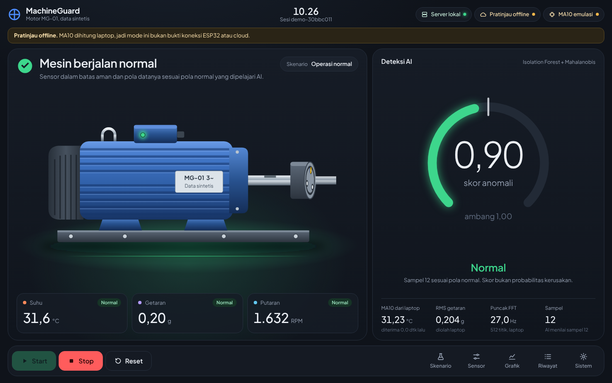
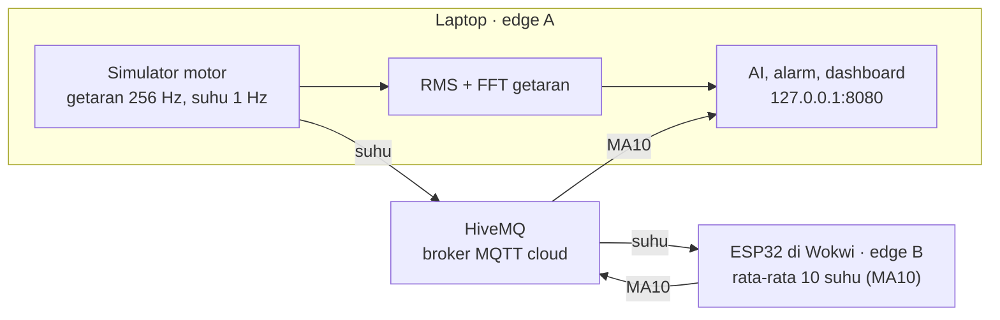
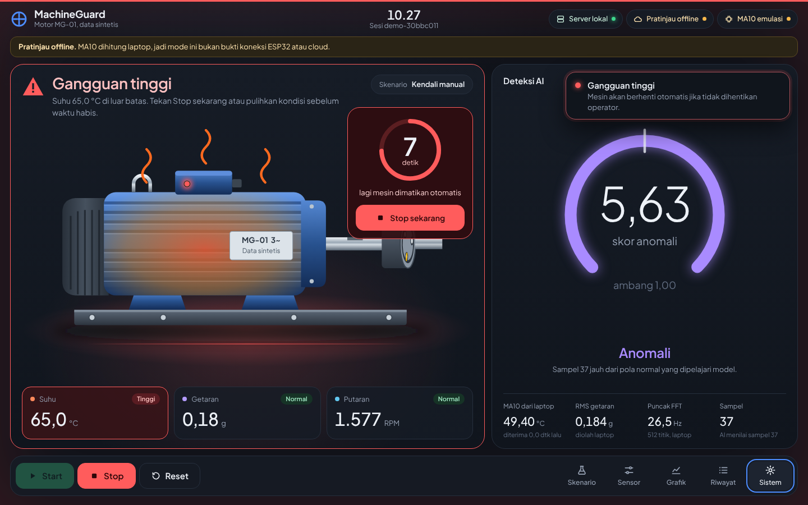

# MachineGuard AI

Sistem pemantauan kondisi motor listrik virtual. Dua edge device saling bertukar data lewat MQTT di cloud, lalu model machine learning menilai apakah pola data motor masih normal. Kalau gangguan sampai di tingkat tinggi, mesin dimatikan otomatis.

Proyek tugas mata kuliah IoT, kelompok 16.



*Dashboard dalam kondisi normal (tangkapan layar mode pratinjau offline).*

- **Coba langsung di browser:** [link GitHub Pages]
- **Panduan mencoba:** [docs/panduan-mencoba.md](docs/panduan-mencoba.md)
- **Video demo:** [link video]

## Ide

Gangguan pada motor listrik, misalnya poros tidak seimbang atau panas berlebih, biasanya terlihat dari getaran dan suhunya. MachineGuard memantau keduanya terus-menerus, memberi peringatan dini lewat AI, dan mematikan mesin otomatis kalau kondisinya sudah berbahaya.

Semua perangkatnya virtual: motor dan sensornya disimulasikan di laptop, ESP32-nya berjalan di simulator Wokwi. Fokus proyek ini adalah alur datanya, dari sensor ke edge, ke cloud, lalu ke AI.

## Arsitektur



Satu sampel data berjalan seperti ini:

1. Laptop membangkitkan 512 titik getaran (256 Hz) dan satu nilai suhu setiap detik.
2. Laptop mengolah getaran menjadi RMS (kekuatan getaran, dalam g) dan frekuensi puncak lewat FFT.
3. Suhu dikirim ke broker HiveMQ. ESP32 yang berlangganan topik itu langsung menerimanya.
4. ESP32 menghitung rata-rata 10 suhu berurutan (MA10) dan mengirim hasilnya kembali lewat HiveMQ.
5. Laptop menggabungkan MA10, RMS, dan RPM dari nomor sampel yang sama, lalu AI menilai.
6. Dashboard menampilkan status, skor AI, dan hitung mundur stop otomatis. Kalau ESP32 berhenti mengirim, dashboard menulis "Data ESP32 basi" dalam 10 detik.



*Saat gangguan tinggi, layar berubah merah dan ada hitung mundur sebelum mesin dimatikan otomatis.*

## Ketentuan tugas

| Ketentuan | Implementasi |
|---|---|
| Minimal 2 edge device | Laptop (Python) dan ESP32 virtual di Wokwi |
| Minimal 2 sensor | Getaran (256 Hz, 512 titik per jendela) dan suhu (1 Hz). Putaran motor (RPM) ikut disimulasikan sebagai sinyal tambahan |
| Minimal 2 jenis pemrosesan data | RMS dan FFT di laptop; rata-rata bergerak 10 sampel (MA10) di ESP32 |
| AI atau algoritma | Isolation Forest + jarak Mahalanobis, dilatih dari data normal |
| Minimal 1 protokol cloud | MQTT lewat broker publik HiveMQ (laptop memakai TLS di port 8883) |
| Dashboard | Web lokal di `http://127.0.0.1:8080`, ditambah versi demo yang bisa dibuka dari mana saja |

## Penerapan AI

- **Input:** tiga angka dari nomor sampel yang sama, yaitu MA10 suhu dari ESP32, RMS getaran, dan RPM.
- **Model:** Isolation Forest (256 pohon) digabung dengan jarak Mahalanobis. Keduanya dilatih hanya dengan data normal. Isolation Forest menangkap titik yang "menyendiri" dari kumpulan data normal, sedangkan Mahalanobis menangkap kombinasi angka yang tidak wajar walaupun tiap angkanya sendiri masih wajar.
- **Output:** skor anomali. Batas tiap komponen diatur pada persentil 99,5 data validasi, jadi skor di atas 1,0 berarti anomali. Skor ini bukan probabilitas kerusakan.
- **Pemisahan peran:** alarm batas dan stop otomatis memakai aturan biasa (misalnya suhu di atas 40 °C). AI berjalan terpisah sebagai peringatan dini. Label skenario uji tidak pernah dipakai sebagai input model.

Data dibagi per sesi supaya model tidak melihat data uji saat belajar:

| Bagian | Isi |
|---|---|
| Train | 96 sesi normal, 16.320 baris |
| Validasi | 32 sesi normal, 5.440 baris, untuk menentukan ambang |
| Uji | Sesi baru: normal dan tiga jenis gangguan |

Hasil pada data uji (sintetis):

| Data uji | Sampel | Alarm dari AI | Alarm batas (pembanding) |
|---|---|---|---|
| Normal | 3.400 | 96 (2,82%) | 0 |
| Getaran berlebih | 2.200 | 2.200 | 2.200 |
| Panas berlebih | 2.200 | 2.200 | 2.200 |
| Putaran berlebih | 2.200 | 2.200 | 2.200 |

Alarm batas biasa juga menangkap semua gangguan uji tanpa alarm palsu, jadi AI bukan pengganti aturan. Nilai tambahnya ada pada pola yang janggal tetapi masih di dalam batas. Contohnya suhu 37 °C dengan getaran 0,18 g dan 1.500 RPM: alarm batas masih NORMAL, tetapi skor AI 1,88 (ANOMALI). Rincian lengkap ada di [docs/hasil-evaluasi.json](docs/hasil-evaluasi.json); file `evaluation.json` dibuat ulang saat model dilatih di komputer masing-masing.

## Menjalankan

Yang dibutuhkan:

- Windows dengan Python 3.10 atau lebih baru
- VS Code dengan ekstensi PlatformIO dan Wokwi Simulator (lisensi Community gratis)
- Koneksi internet (untuk broker HiveMQ)

### 1. ESP32 di Wokwi (edge B)

1. Buka folder `edge_esp32` di VS Code.
2. Build lewat tombol centang PlatformIO di status bar bawah, tunggu sampai muncul `SUCCESS`.
3. Tekan `Ctrl+Shift+P`, pilih **Wokwi: Start Simulator**.
4. Biarkan tab Wokwi Simulator tetap terbuka. Menutup tab itu menghentikan ESP32.

Terminal Wokwi akan menampilkan baris seperti `seq   12 | suhu  31.84 C | buffer 10/10` dan `seq   12 | MA10  31.62 C | ke laptop`.

### 2. Laptop (edge A)

Klik dua kali `jalankan.cmd`. Saat pertama kali, peluncur menyiapkan `.venv`, memasang dependensi, dan melatih model (sekitar satu menit). Setelah itu browser terbuka di `http://127.0.0.1:8080`. Klik **Start**.

Di luar Windows:

```bash
python -m venv .venv
source .venv/bin/activate
pip install -r requirements.txt
python app.py --open
```

### Tanpa Wokwi

`jalankan-offline.cmd` membuka dashboard di port 8081 dengan MA10 dihitung oleh laptop. Mode ini diberi label jelas di dashboard dan tidak dipakai sebagai bukti dua edge.

## Demo di browser (GitHub Pages)

Dashboard yang sama bisa berjalan tanpa server Python. Mode ini aktif otomatis saat halaman dibuka dari GitHub Pages atau langsung sebagai file. Simulator, pemrosesan getaran, alarm, dan model AI berjalan di browser; ESP32 dan MQTT diemulasikan dan dashboard menyatakannya di banner atas. Model di browser adalah model yang sama, diekspor ke `dashboard/model.js` lewat `tools/export_model_js.py`.

Cara menerbitkan:

1. Repo harus publik. Buka **Settings → Pages**.
2. Source: **Deploy from a branch**, branch `main`, folder `/ (root)`, lalu **Save**.
3. Setelah 1–2 menit, demo bisa dibuka di `https://<username>.github.io/<nama-repo>/`.

Kalau model dilatih ulang dengan versi scikit-learn yang berbeda, jalankan `python tools/export_model_js.py` supaya `model.js` ikut diperbarui.

## Komunikasi MQTT

| Bagian | Nilai |
|---|---|
| Broker | `broker.hivemq.com` |
| Laptop | Port 8883, TLS |
| ESP32 | Port 1883 tanpa TLS (Wokwi), karena itu hanya data sintetis yang dikirim |
| Topik suhu | `mg/v1/machineguard-f3cfa8ca05/motor01/sensor/temperature` |
| Topik MA10 | `mg/v1/machineguard-f3cfa8ca05/motor01/feature/temperature` |

Setiap pesan membawa `run_id`, nomor urut `seq`, dan waktu simulasi. Laptop menolak MA10 dari sesi lama, duplikat, atau yang nilainya tidak cocok dengan 10 suhu yang dikirim. Akhiran acak pada topik mencegah bentrok dengan pengguna lain di broker publik; kalau diganti, ubah juga di `config.py` dan `edge_esp32/src/main.cpp`.

## Pelajari kodenya

- `app.py` → edge A: server dashboard, koneksi MQTT ke HiveMQ, dan alur data laptop
- `simulation.py` → motor virtual, sensor getaran dan suhu, serta pemrosesan RMS dan FFT
- `edge_esp32/src/main.cpp` → edge B: menerima suhu, menghitung MA10, mengirim balik
- `engine.py` → status mesin, alarm batas, stop otomatis, dan penggabungan MA10 dengan fitur laptop
- `detector.py` → model AI (Isolation Forest + jarak Mahalanobis)
- `train_model.py` → pelatihan dan evaluasi model
- `messages.py` → format dan validasi pesan MQTT
- `config.py` → alamat broker dan topik
- `dashboard/` → tampilan web, mesin demo browser (`demo-engine.js`), dan model untuk browser (`model.js`)
- `tests/` → unit test dan uji integrasi MQTT lokal
- `docs/` → panduan mencoba, catatan pengujian, hasil evaluasi, gambar

## Pengujian

```bash
python -m unittest discover -s tests -v
```

23 unit test memeriksa simulator, pemrosesan getaran, validasi pesan, alarm, dan stop otomatis. Ringkasan pengujian lainnya, termasuk uji koneksi ESP32 dan tampilan dashboard, ada di [docs/pengujian.md](docs/pengujian.md).

## Kalau ada masalah

- **Dashboard terus "Menunggu ESP32" atau "Data ESP32 basi":** tab Wokwi Simulator harus tetap terbuka dan timernya berjalan. Klik tombol hijau ↻ di simulator untuk memulai ulang.
- **Wokwi: Start Simulator tidak memunculkan apa pun:** tekan `Ctrl+Shift+P`, pilih **Developer: Reload Window**, lalu coba lagi.
- **Port 8080 sedang dipakai:** tutup jendela CMD MachineGuard lain dengan `Ctrl+C`.

Daftar lengkapnya ada di [panduan mencoba](docs/panduan-mencoba.md#kalau-ada-masalah).

## Keterbatasan

- Datanya sintetis dari simulator, belum mewakili motor nyata.
- Broker publik tanpa autentikasi, dan ESP32 di Wokwi tidak memakai TLS.
- Sistem mendeteksi pola tidak biasa, bukan memprediksi kapan mesin rusak.
- Model hanya diuji pada skenario yang disimulasikan.

## Anggota kelompok

| Nama | NIM |
|---|---|
| John Vito Gracielo Talaksoru | 24060125140200 |
| Rajendra Ziven Abiseka | 24060125140241 |
| Arkano Aqilla Tristanoza | 24060125130073 | 


